# Корпоративный сервис ведения документации на базе MediaWiki (High Availability)

## О проекте
Данный проект представляет собой развертывание корпоративной базы знаний на базе MediaWiki. 
Главная особенность решения — **отказоустойчивая архитектура** (High Availability), спроектированная для минимизации времени простоя (Downtime) в случае выхода из строя отдельных компонентов инфраструктуры.

**Основные требования:**
*   **ОС:** Ubuntu 24.04 LTS
*   **Нагрузка:** до 40 пользователей (с возможностью масштабирования)
*   **Специфика:** Работа через веб-интерфейс (HTTP/HTTPS), хранение медиафайлов, одновременное редактирование документов.


## Архитектура решения

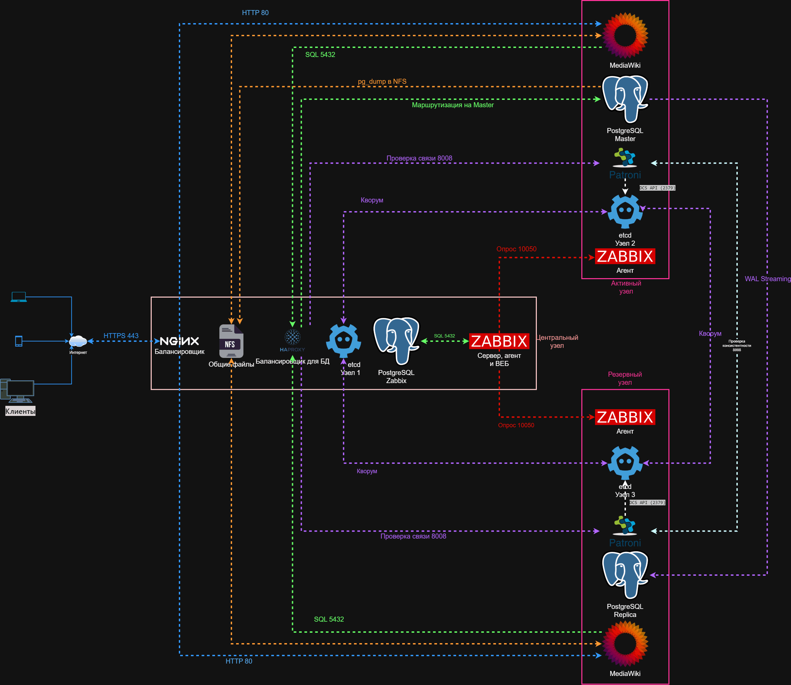

Проект развернут на **3 виртуальных машинах (ВМ)**:

1.  **ВМ1 :**
    *   **Nginx:** Балансировщик веб-трафика (L7) для экземпляров MediaWiki.
    *   **HAProxy:** Балансировщик SQL-трафика (L4) для маршрутизации запросов к текущему Master-узлу БД.
    *   **NFS Server:** Сетевое хранилище для общих файлов (изображений) MediaWiki и резервных копий.
    *   **Zabbix Server:** Система мониторинга.
    *   **etcd (узел 1):** Хранилище конфигурации (DCS) для кластера Patroni.
2.  **ВМ2 (Активный узел):**
    *   **MediaWiki:** Веб-приложение (PHP-FPM + Nginx).
    *   **PostgreSQL (Primary):** Главная база данных (Master).
    *   **Patroni:** Агент управления кластером БД.
    *   **etcd (узел 2):** Участник кворума.
3.  **ВМ3 (Резервный узел):**
    *   **MediaWiki:** Второй экземпляр веб-приложения.
    *   **PostgreSQL (Replica):** Резервная база данных (Hot Standby).
    *   **Patroni:** Агент управления кластером БД.
    *   **etcd (узел 3):** Участник кворума.

## Инструкция по развертыванию (Кратко)
1. Установка NFS-Server на ВМ1 и монтирование на ВМ2/ВМ3.
2. Развертывание кластера etcd на всех трех ВМ.
3. Установка и настройка Patroni и PostgreSQL на ВМ2/ВМ3.
4. Настройка HAProxy на ВМ1.
5. Установка MediaWiki на ВМ2/ВМ3 и связка с БД через HAProxy.
6. Настройка Nginx на ВМ1.
7. Настройка скриптов бэкапа и Zabbix.

### Шаг 1: Подготовка окружения.

На всех машинах обновляем репозитории и устанавливаем базовые утилиты:
```bash
sudo apt update
sudo apt install -y curl wget gnupg2 software-properties-common ufw
```

Сразу настроим имена хостов:
```bash
sudo hostnamectl set-hostname vm1-lb-infra       # На ВМ1
sudo hostnamectl set-hostname vm2-app-db-master  # На ВМ2
sudo hostnamectl set-hostname vm3-app-db-replica # На ВМ3
```

Добавим, для удобства, записи в конец файла `/etc/hosts` на всех ВМ:
```
IP1 vm1-lb-infra
IP2 vm2-app-db-master
IP3 vm3-app-db-replica
```
Столкнулся с проблемой что нужно перед перезагрузкой, чтобы записи в `/etc/hosts` сохранились, добавить один файл в `/etc/cloud/cloud.cfg.d/`
```bash
echo 'manage_etc_hosts: false' | sudo tee /etc/cloud/cloud.cfg.d/99-zz-disable-etc-hosts.cfg
manage_etc_hosts: false 
ls -1 /etc/cloud/cloud.cfg.d/ | sort # И по хорошему проверить что наш файл идёт последним
```

Проверим синхронизацию времени:
```bash
timedatectl status
```


### Шаг 2: Настройка NFS-сервера

На ВМ1:
```bash
sudo apt install -y nfs-kernel-server nfs-common
```
Создадим на ВМ1 каталог для общих файлов и будущих бэкапов:
```bash
sudo mkdir -p /srv/shares/mediawiki_images
sudo chown -R www-data:www-data /srv/shares/mediawiki_images # присвоим права пользователю веб-сервера
```
Настроим экспорт для нужной подсети (в данном случае 10.88.0.0/24):
```
sudo vim /etc/exports # редактируем доступ в этом файле
/srv/shares/mediawiki_images 10.88.0.0/24(rw,sync,no_subtree_check,all_squash,anonuid=33,anongid=33) # добавляем эту строку в конец файла
```

Запустим сервис и проверим экспорт папки:

```bash
sudo exportfs -a
sudo systemctl restart nfs-server
sudo systemctl enable nfs-server 
sudo showmount -e localhost # проверка экспорта каталога
```
Сделаем так, чтобы служба перезапускалась при падении.
```bash
sudo mkdir -p /etc/systemd/system/nfs-server.service.d
sudo tee /etc/systemd/system/nfs-server.service.d/override.conf > /dev/null <<'EOF'
[Unit]
After=network-online.target
Wants=network-online.target

[Service]
Restart=on-failure
RestartSec=5
EOF
sudo systemctl daemon-reload
```


### Шаг 3: Настройка NFS-клиентов на оставшихся машинах
На оставшихся ВМ выполняем:
```bash
sudo apt install -y nfs-common
```
Создаём каталог для монтирования общих файлов:
```bash
sudo mkdir -p /var/www/html/images
```
Монтирование сетевой папки:
```bash
sudo mount -t nfs vm1-lb-infra:/srv/shares/mediawiki_images /var/www/html/images
```
На всех клиентских ВМ можно совершить проверку монтирования:
```bash
sudo touch /var/www/html/images/test_from_vmX.txt #
```
После этого проверим появились ли файлы на NFS-сервере:
```bash
ls -la /srv/shares/mediawiki_images/ # будут файлы пользователя www-data
```

Настроим на каждой клиенсткой ВМ автомонтирование:
```bash
sudo vim /etc/fstab
# добавим в конец эту строку
vm1-lb-infra:/srv/shares/mediawiki_images /var/www/html/images nfs defaults,_netdev,x-systemd.automount 0 0
# После этого выполним.
sudo systemctl daemon-reload
sudo mount -a
```
Если NFS-сервер работает корректно и монтируется, можем приступить к настройке etcd-серверов и создания кворума.


# Шаг 4: Настройка кластера etcd
На всех ВМ выполняем:
```bash
sudo apt install -y etcd-server etcd-client
sudo systemctl stop etcd          # остановим службу для очистки стандартной конфигурации
sudo rm -rf /var/lib/etcd/default # удаляем базовую конфигурацию с одиночным экземпляром
```
После этого можно создать файлы конфигурации на всех машинах:
В моём случае, с имеющимися адресами конфигурация файлов `/etc/default/etcd` выглядела так:
ВМ1:
```bash
ETCD_NAME="vm1-lb-infra"
ETCD_INITIAL_CLUSTER="vm1-lb-infra=http://vm1-lb-infra:2380,vm2-app-db-master=http://vm2-app-db-master:2380,vm3-app-db-replica=http://vm3-app-db-replica:2380"
ETCD_INITIAL_ADVERTISE_PEER_URLS="http://vm1-lb-infra:2380"
ETCD_ADVERTISE_CLIENT_URLS="http://vm1-lb-infra:2379"
ETCD_LISTEN_PEER_URLS="http://__VM1IP:2380"                          # в переменных LISTEN нужно прописывать именно IP адреса
ETCD_LISTEN_CLIENT_URLS="http://__VM1IP:2379,http://127.0.0.1:2379"  # в переменных LISTEN нужно прописывать именно IP адреса
ETCD_INITIAL_CLUSTER_STATE="new"
ETCD_INITIAL_CLUSTER_TOKEN="etcd-cluster-1"
```
ВМ2:
```bash
ETCD_NAME="vm2-app-db-master"
ETCD_INITIAL_CLUSTER="vm1-lb-infra=http://vm1-lb-infra:2380,vm2-app-db-master=http://vm2-app-db-master:2380,vm3-app-db-replica=http://vm3-app-db-replica:2380"
ETCD_INITIAL_ADVERTISE_PEER_URLS="http://vm2-app-db-master:2380"
ETCD_ADVERTISE_CLIENT_URLS="http://vm2-app-db-master:2379"
ETCD_LISTEN_PEER_URLS="http://__VM2IP:2380"                          # в переменных LISTEN нужно прописывать именно IP адреса
ETCD_LISTEN_CLIENT_URLS="http://__VM2IP:2379,http://127.0.0.1:2379"  # в переменных LISTEN нужно прописывать именно IP адреса
ETCD_INITIAL_CLUSTER_STATE="new"
ETCD_INITIAL_CLUSTER_TOKEN="etcd-cluster-1"
```

ВМ3:
```bash
ETCD_NAME="vm3-app-db-replica"
ETCD_INITIAL_CLUSTER="vm1-lb-infra=http://vm1-lb-infra:2380,vm2-app-db-master=http://vm2-app-db-master:2380,vm3-app-db-replica=http://vm3-app-db-replica:2380"
ETCD_INITIAL_ADVERTISE_PEER_URLS="http://vm3-app-db-replica:2380"
ETCD_ADVERTISE_CLIENT_URLS="http://vm3-app-db-replica:2379"
ETCD_LISTEN_PEER_URLS="http://__VM13P:2380"                          # в переменных LISTEN нужно прописывать именно IP адреса
ETCD_LISTEN_CLIENT_URLS="http://__VM3IP:2379,http://127.0.0.1:2379"  # в переменных LISTEN нужно прописывать именно IP адреса
ETCD_INITIAL_CLUSTER_STATE="new"
ETCD_INITIAL_CLUSTER_TOKEN="etcd-cluster-1"
```
После настройки конфигураций на всех серверах, можно запускать службу etcd:
```bash
sudo systemctl enable --now etcd
sudo systemctl status etcd --no-pager

# Сделаем так, чтобы служба не отваливалась после перезагрузки. RestartSec сделал побольше, для того чтобы успеть посмотреть логи.
sudo mkdir -p /etc/systemd/system/etcd.service.d

sudo tee /etc/systemd/system/etcd.service.d/override.conf > /dev/null <<'EOF'
[Unit]
After=network-online.target time-sync.target
Wants=network-online.target

[Service]
TimeoutStartSec=300
Restart=on-failure
RestartSec=30
EOF
sudo systemctl daemon-reload
```

После этого можно проверить работу `etcd`.

Для этого я подготовил скрипт check_etcd.sh:
```bash
vim check_etcd.sh
...
#!/bin/bash
ETCDCTL_API=3 etcdctl member list # увидим наши узлы из которых состоит кворум
ETCDCTL_API=3 etcdctl endpoint health --cluster # можно проверить здоровье кластера
ETCDCTL_API=3 etcdctl endpoint status --cluster -w table # показывает детальный статус каждого узла (лидер, размер БД, индексы Raft) в виде удобной таблицы
ETCDCTL_API=3 etcdctl alarm list # проверяет наличие системных тревог (например, нехватку места NOSPACE или повреждение данных)
ETCDCTL_API=3 etcdctl endpoint hashkv --cluster # выводит хэш данных для каждого узла, чтобы убедиться, что база на всех нодах абсолютно идентична
...
chmod +x check_etcd.sh # не забываем про права
```


### Шаг 5: Настройка Postgresql и Patroni

На клиентских ВМ настраиваем Patroni. Он будет управлять нашими СУБД (при этом, сам postgresql должен быть отключен), опираясь на данные из `etcd`

```bash
# Сперва установим репозиторий postgresql (если мы к примеру, работаем на debian)
sudo apt install -y postgresql-common
sudo /usr/share/postgresql-common/pgdg/apt.postgresql.org.sh

# После, у нас будет возможность установить нужную версию
sudo apt install -y postgresql-16 patroni python3-etcd python3-grpcio python3-etcd3
sudo systemctl disable --now postgresql # Остановка и отключение стандартного PostgreSQL
sudo pg_dropcluster --stop 16 main # Удаление кластера по умолчанию, чтобы Patroni мог создать свой
sudo rm -rf /var/lib/postgresql/16/main
```
Приступим к настройке конфигураций Patroni на наших ВМ.
Для этого будем редактировать файл `/etc/patroni/config.yml`
На ВМ2:
```bash
scope: postgres
namespace: /db/
name: vm2-app-db-master

restapi:
  listen: vm2-app-db-master:8008
  connect_address: vm2-app-db-master:8008

etcd3:
  hosts: vm1-lb-infra:2379,vm2-app-db-master:2379,vm3-app-db-replica:2379

bootstrap:
  dcs:
    ttl: 30
    loop_wait: 10
    retry_timeout: 10
    maximum_lag_on_failover: 1048576
    postgresql:
      use_pg_rewind: true
      use_slots: true
      parameters:
        wal_level: replica
        hot_standby: "on"
        wal_keep_segments: 10
        max_wal_senders: 10
        max_replication_slots: 10
        wal_log_hints: "on"

  initdb:
  - encoding: UTF8
  - data-checksums

  pg_hba:
  - host replication replicator 10.88.16.0/20 md5
  - host all all 10.88.16.0/20 md5

postgresql:
  listen: vm2-app-db-master:5432
  connect_address: vm2-app-db-master:5432
  data_dir: /var/lib/postgresql/16/main
  bin_dir: /usr/lib/postgresql/16/bin
  pgpass: /tmp/pgpass
  authentication:
    replication:
      username: replicator
      password: strong_replication_password
    superuser:
      username: postgres
      password: strong_postgres_password
  parameters:
    unix_socket_directories: '/var/run/postgresql'

tags:
    nofailover: false
    noloadbalance: false
    clonefrom: false
    nosync: false
```
На ВМ3:
```bash
scope: postgres
namespace: /db/
name: vm3-app-db-replica

restapi:
  listen: vm3-app-db-replica:8008
  connect_address: vm3-app-db-replica:8008

etcd3:
  hosts: vm1-lb-infra:2379,vm2-app-db-master:2379,vm3-app-db-replica:2379

bootstrap:
  dcs:
    ttl: 30
    loop_wait: 10
    retry_timeout: 10
    maximum_lag_on_failover: 1048576
    postgresql:
      use_pg_rewind: true
      use_slots: true
      parameters:
        wal_level: replica
        hot_standby: "on"
        wal_keep_segments: 10
        max_wal_senders: 10
        max_replication_slots: 10
        wal_log_hints: "on"

  initdb:
  - encoding: UTF8
  - data-checksums

  pg_hba:
  - host replication replicator 10.88.16.0/20 md5
  - host all all 10.88.16.0/20 md5

postgresql:
  listen: vm3-app-db-replica:5432
  connect_address: vm3-app-db-replica:5432
  data_dir: /var/lib/postgresql/16/main
  bin_dir: /usr/lib/postgresql/16/bin
  pgpass: /tmp/pgpass
  authentication:
    replication:
      username: replicator
      password: strong_replication_password
    superuser:
      username: postgres
      password: strong_postgres_password
  parameters:
    unix_socket_directories: '/var/run/postgresql'

tags:
    nofailover: false
    noloadbalance: false
    clonefrom: false
    nosync: false
```

Изменим владельца:
```bash
sudo chown postgres:postgres /etc/patroni/config.yml
sudo chmod 640 /etc/patroni/config.yml
```

Запустим Patroni на наших ВМ:
```bash
# Перед запуском проверим импорт модулей
sudo -u postgres python3 -c "import etcd3; import etcd; import patroni.dcs.etcd3" && echo "Модули успешно импортированы!"
# Запускаем
sudo systemctl enable --now patroni
```

Добавим override, чтобы служба перезапускалась в случае падения раз в 15 секунд
```bash
sudo mkdir -p /etc/systemd/system/patroni.service.d
sudo tee /etc/systemd/system/patroni.service.d/override.conf > /dev/null <<'EOF'
[Service]
Restart=on-failure
RestartSec=15
EOF
sudo systemctl daemon-reload
```

Проверим статус кластера.
```bash
sudo patronictl -c /etc/patroni/config.yml list
```
```bash
В моём случае вывод была такой
```bash
+ Cluster: postgres (7705490895703706820) ---+-----------+----+-----------+
| Member             | Host        | Role    | State     | TL | Lag in MB |
+--------------------+-------------+---------+-----------+----+-----------+
| vm2-app-db-master  | 10.88.0.113 | Leader  | running   |  3 |           |
| vm3-app-db-replica | 10.88.0.195 | Replica | streaming |  3 |         0 |
+--------------------+-------------+---------+-----------+----+-----------+
```
Если всё в порядке можно переходить к настройке оркестровищка HAProxy.


### Шаг 6: Настройка HAProxy на главном узле (ВМ1)

На ВМ1:
```bash
sudo apt install -y haproxy postgresql-client
```
После приведём файл `/etc/haproxy/haproxy.cfg` к такому виду:
```bash
global
        log /dev/log    local0
        log /dev/log    local1 notice
        chroot /var/lib/haproxy
        stats socket /run/haproxy/admin.sock mode 660 level admin
        stats timeout 30s
        user haproxy
        group haproxy
        daemon

        # Default SSL material locations (можно оставить, они не мешают TCP)
        ca-base /etc/ssl/certs
        crt-base /etc/ssl/private
        ssl-default-bind-ciphers ECDHE-ECDSA-AES128-GCM-SHA256:ECDHE-RSA-AES128-GCM-SHA256:ECDHE-ECDSA-AES256-GCM-SHA384:ECDHE-RSA-AES256-GCM-SHA384:ECDHE-ECDSA-CHACHA20-POLY1305:ECDHE-RSA-CHACHA20-POLY1305:DHE-RSA-AES128-GCM-SHA256:DHE-RSA-AES256-GCM-SHA384
        ssl-default-bind-ciphersuites TLS_AES_128_GCM_SHA256:TLS_AES_256_GCM_SHA384:TLS_CHACHA20_POLY1305_SHA256
        ssl-default-bind-options ssl-min-ver TLSv1.2 no-tls-tickets

defaults
        log     global
        mode    tcp
        option  tcplog
        option  dontlognull
        retries 3
        timeout connect 5s
        timeout client  30s
        timeout server  30s
        # Отключаем стандартные HTTP-ошибки, так как мы работаем с TCP
        # errorfile 400 /etc/haproxy/errors/400.http
        # errorfile 403 /etc/haproxy/errors/403.http
        # errorfile 408 /etc/haproxy/errors/408.http
        # errorfile 500 /etc/haproxy/errors/500.http
        # errorfile 502 /etc/haproxy/errors/502.http
        # errorfile 503 /etc/haproxy/errors/503.http
        # errorfile 504 /etc/haproxy/errors/504.http

frontend postgres_frontend
        bind *:5432
        mode tcp
        default_backend postgres_backend

backend postgres_backend
        mode tcp
        option httpchk GET /primary
        http-check expect status 200
        
       server vm2-app-db-master vm2-app-db-master:5432 check port 8008
       server vm3-app-db-replica vm3-app-db-replica:5432 check port 8008
```

Перезапуск и проверка:
```bash
sudo systemctl restart haproxy
sudo systemctl status haproxy --no-pager
```
Опять же добавим override.conf и для HAProxy. А вдруг...
```bash
sudo mkdir -p /etc/systemd/system/haproxy.service.d
sudo tee /etc/systemd/system/haproxy.service.d/override.conf > /dev/null <<'EOF'
[Unit]
# Гарантирует, что HAProxy стартует только после полной готовности сети
After=network-online.target
Wants=network-online.target

[Service]
# Автоматически перезапускать при сбое (в отличие от etcd, здесь это безопасно и полезно)
Restart=always
RestartSec=3
EOF
sudo systemctl daemon-reload
```

Проверим подключение к БД одной из наших машин, в зависимости от текущего состояни `etcd`:
Пароли для мастера: strong_postgres_password
Для реплики: strong_replication_password
```bash
psql -h 127.0.0.1 -p 5432 -U postgres -W -c "SELECT inet_server_addr(), pg_is_in_recovery();"
```

По хорошему, команда должна вывести адрес текущего лидера и `f` (false).


### Шаг 7: Подготовка базы данных и установка MediaWiki
На ВМ1:
```bash
psql -h 127.0.0.1 -p 5432 -U postgres -W # В конфиге указывали пароль strong_postgres_password
```
В консоли `postgres` выполним:
```sql
CREATE USER wikiuser WITH PASSWORD 'wiki_password';
CREATE DATABASE my_wiki OWNER wikiuser;
\q
```
После создания БД настроим nginx. Это нужно сделать на ВМ2 и ВМ3
```bash
sudo apt install -y nginx php-fpm php-intl php-mbstring php-xml php-apcu php-curl php-pgsql php-gd imagemagick
```
Так же необходимо указать путь для хранения сессий php, иначе установщик MediaWiki выдаст ошибку "Данные сессии потеряны".
В файле `/etc/php/8.X/fpm/php.ini` нужно раскомментировать строку:
`session.save_path = "/var/lib/php/sessions`
После выполнить 
```bash
sudo mkdir -p /var/lib/php/sessions
sudo chown www-data:www-data /var/lib/php/sessions
sudo systemctl restart php8.X-fpm
```
Установка **MediaWiki**:
```bash
cd /tmp
wget https://releases.wikimedia.org/mediawiki/1.42/mediawiki-1.42.1.tar.gz
tar -xzvf mediawiki-1.42.1.tar.gz
```
Перемещаем файлы в `/var/www/html`.
```bash
sudo cp -r /tmp/mediawiki-1.42.1/* /var/www/html/
sudo chown -R www-data:www-data /var/www/html # не забываем передать права
sudo chmod -R 755 /var/www/html/
```
Настроим конфиг дефолтного сайта:
```bash
sudo vim /etc/nginx/sites-available/default
```
```nginx
server {
    listen 80 default_server;
    listen [::]:80 default_server;
    root /var/www/html;
    index index.php index.html index.htm;
    server_name _;

    location / {
        try_files $uri $uri/ =404;
    }

    location ~ \.php$ {
        include snippets/fastcgi-php.conf;
        fastcgi_pass unix:/run/php/php8.X-fpm.sock;
    }

    location ~ /\.ht {
        deny all;
    }
}
```
Перезапуск `nginx`
```bash
sudo systemctl restart nginx
sudo systemctl enable nginx
```
Теперь настроим nginx с балансировщиком с ip_hash;

На ВМ1:
```bash
sudo apt install -y nginx
```
Я хочу чтобы с внешки был https, поэтому создадим сертификат:
```bash
sudo mkdir -p /etc/nginx/ssl
sudo openssl req -x509 -newkey rsa:4096 -days 36500 -keyout /etc/nginx/ssl/privkey.pem -out /etc/nginx/ssl/cert.pem -subj "/CN=mediawiki.local" -nodes
```
```bash
sudo vim /etc/nginx/sites-available/default
```
```nginx
# Блок для перенаправления всего HTTP-трафика на HTTPS
server {
    listen 80 default_server;
    listen [::]:80 default_server;
    server_name _;
    return 301 https://$host$request_uri;
}

# Блок для HTTPS
server {
    listen 443 ssl default_server;
    listen [::]:443 ssl default_server;
    server_name _;

    # Пути к нашему самоподписанному сертификату и ключу
    ssl_certificate /etc/nginx/ssl/cert.pem;
    ssl_certificate_key /etc/nginx/ssl/privkey.pem;

    # Дополнительные настройки SSL для безопасности
    ssl_protocols TLSv1.2 TLSv1.3;
    ssl_ciphers HIGH:!aNULL:!MD5;

    location / {
        proxy_pass http://mediawiki_backend;
        proxy_set_header Host $host;
        proxy_set_header X-Real-IP $remote_addr;
        proxy_set_header X-Forwarded-For $proxy_add_x_forwarded_for;
        # Этот заголовок говорит MediaWiki, что исходный запрос был по HTTPS
        proxy_set_header X-Forwarded-Proto $scheme;
        add_header X-Content-Type-Options nosniff;
    }
}

# Определение нашего бэкенда
upstream mediawiki_backend {
    ip_hash; # привязка сессий
    server 10.88.0.113:80;
    server 10.88.0.195:80;
}
```
```bash
sudo nginx -t
sudo systemctl restart nginx
```


Ещё полезно на всех ВМ выполнить:
```bash
sudo mkdir -p /etc/systemd/system/nginx.service.d
sudo tee /etc/systemd/system/nginx.service.d/override.conf > /dev/null <<'EOF'
[Unit]
# Гарантирует запуск после полной готовности сети, а не просто network.target
After=network-online.target
Wants=network-online.target

[Service]
# Поднимает лимит открытых файловых дескрипторов (ключевая настройка)
LimitNOFILE=65535
# Автоматически перезапускает Nginx при сбое
Restart=on-failure
RestartSec=10
EOF
sudo systemctl daemon-reload
```

Перед установкой можно позапускать скрипты на ВМ. Чтобы проверить правильную настройку сервисов после перезагрузки.

На ВМ1:
```bash
#!/bin/bash

sudo systemctl status nfs-server --no-pager
sudo showmount -e localhost # проверка экспорта каталога

sudo systemctl status etcd --no-pager
sudo systemctl status haproxy --no-pager

sudo systemctl status nginx --no-pager

ETCDCTL_API=3 etcdctl member list # увидим наши узлы из которых состоит кворум
ETCDCTL_API=3 etcdctl endpoint health --cluster # можно проверить здоровье кластера
ETCDCTL_API=3 etcdctl endpoint status --cluster -w table # показывает детальный статус каждого узла (лидер, размер БД, индексы Raft) в виде удобной таблицы
ETCDCTL_API=3 etcdctl alarm list # проверяет наличие системных тревог (например, нехватку места NOSPACE или повреждение данных)
ETCDCTL_API=3 etcdctl endpoint hashkv --cluster # выводит хэш данных для каждого узла, чтобы убедиться, что база на всех нодах абсолютно идентична

```


На клиентских ВМ:
```bash
#!/bin/bash

sudo systemctl status nfs-client.target --no-pager

sudo systemctl status etcd --no-pager

ETCDCTL_API=3 etcdctl member list # увидим наши узлы из которых состоит кворум
ETCDCTL_API=3 etcdctl endpoint health --cluster # можно проверить здоровье кластера
ETCDCTL_API=3 etcdctl endpoint status --cluster -w table # показывает детальный статус каждого узла (лидер, размер БД, индексы Raft) в виде удобной таблицы
ETCDCTL_API=3 etcdctl alarm list # проверяет наличие системных тревог (например, нехватку места NOSPACE или повреждение данных)
ETCDCTL_API=3 etcdctl endpoint hashkv --cluster # выводит хэш данных для каждого узла, чтобы убедиться, что база на всех нодах абсолютно идентична

systemctl status nginx --no-pager

sudo systemctl status patroni --no-pager

sudo patronictl -c /etc/patroni/config.yml list

```
После успешной установки скачиваем файл LocalSettings.php
И рассылаем его по нашим ВМ

Я к примеру, при помощи WinSCP перекинул его сразу в папку ВМ2 `/var/www/html/`
После осталось установить права:
```bash
sudo chown www-data:www-data /var/www/html/LocalSettings.php
sudo chmod 600 /var/www/html/LocalSettings.php
```
Нужно скопировать конфигурацию на ВМ3:
```bash
sudo cp /var/www/html/LocalSettings.php /var/www/html/images/ # Выполняем на ВМ2
```
На ВМ3 в свою очередь забираем файл:
```bash
sudo cp /var/www/html/images/LocalSettings.php /var/www/html/
sudo chown www-data:www-data /var/www/html/LocalSettings.php
sudo chmod 600 /var/www/html/LocalSettings.php
```
С ВМ2 удаляем лишний файл:
```bash
sudo rm /var/www/html/images/LocalSettings.php
```


### Шаг 8: Настройка резервного копирования

Подготовка хранилища для бэкапов на ВМ1:

```bash
sudo mkdir -p /srv/shares/backups
sudo chown -R www-data:www-data /srv/shares/backups
```
После, в файл `/etc/exports` добавим:
`/srv/shares/backups 10.88.0.0/24(rw,sync,no_subtree_check,all_squash,anonuid=33,anongid=33)`
Выполним:
```bash
sudo systemctl daemon-reload
sudo exportfs -a
sudo systemctl restart nfs-kernel-server
```

На клиентских ВМ:
```
sudo mkdir -p /mnt/backups
sudo mount -t nfs vm1-lb-infra:/srv/shares/backups /mnt/backups
```

Для автомонтирования добавил такую строку в `/etc/fstab`:
`vm1-lb-infra:/srv/shares/backups /mnt/backups nfs defaults,_netdev,x-systemd.automount 0 0`
После того как хранилище для backup'ов готово. Можно создавать скрипты:
Дла бэкапов БД можно использовать **ВМ1**, тк на ней стоит HAProxy:
```
sudo vim /usr/local/bin/backup_db.sh
```
С таким содержимым:
```bash
#!/bin/bash

# Значения по умолчанию для аргументов командной строки
DB_NAME="${1:-my_wiki}"
BACKUP_DIR="${2:-/srv/shares/backups/db}"
RETENTION_DAYS="${3:-7}"

# Переменные
DATE=$(date +%Y-%m-%d_%H-%M-%S)
BACKUP_FILE="${BACKUP_DIR}/${DB_NAME}_${DATE}.sql"
DB_HOST="127.0.0.1"
DB_USER="wikiuser"
export PGPASSWORD="wiki_password"

# Функция для вывода сообщений об ошибках
log_error() {
    echo "[ERROR] $(date '+%Y-%m-%d %H:%M:%S') - $1" >&2
}

# Функция для вывода информационных сообщений
log_info() {
    echo "[INFO] $(date '+%Y-%m-%d %H:%M:%S') - $1"
}

# Проверка наличия директории для бэкапов
if [ ! -d "$BACKUP_DIR" ]; then
    log_info "Создаем директорию для бэкапов: $BACKUP_DIR"
    mkdir -p "$BACKUP_DIR" || { log_error "Не удалось создать $BACKUP_DIR"; exit 1; }
fi

log_info "Начинаем резервное копирование БД '$DB_NAME'..."

# Выполнение pg_dump
pg_dump -h "$DB_HOST" -U "$DB_USER" -d "$DB_NAME" -F c -b -v -f "$BACKUP_FILE" > /dev/null 2>&1

if [ $? -eq 0 ]; then
    log_info "Бэкап БД успешно создан: $BACKUP_FILE"
else
    log_error "Ошибка при создании бэкапа БД!"
    exit 1
fi

# Удаление старых бэкапов (ротация)
log_info "Удаляем бэкапы старше $RETENTION_DAYS дней..."
find "$BACKUP_DIR" -type f -name "${DB_NAME}_*.sql" -mtime +"$RETENTION_DAYS" -exec rm -f {} \;

log_info "Процесс резервного копирования завершен."
```
Не забываем про права:
```bash
sudo chmod +x /usr/local/bin/backup_db.sh
```
Сразу настроим планировщик:
```bash
sudo crontab -e
```
В конце добавим:
```cron
0 2 * * * /usr/local/bin/backup_db.sh >> /var/log/backup_db.log 2>&1 # каждый день в 2:00 ночи
```

Для бэкапов файловой системы, будем использовать клиентские ВМ:
На обеих ВМ создадим:
```bash
sudo vim /usr/local/bin/backup_fs.sh
```
```bash
#!/bin/bash

# Значения по умолчанию
SOURCE_DIR="${1:-/var/www/html}"
BACKUP_DIR="${2:-/mnt/backups/fs}"
RETENTION_DAYS="${3:-7}"

DATE=$(date +%Y-%m-%d_%H-%M-%S)
HOSTNAME=$(hostname)
BACKUP_FILE="${BACKUP_DIR}/mediawiki_${HOSTNAME}_${DATE}.tar.gz"

log_error() { echo "[ERROR] $(date '+%Y-%m-%d %H:%M:%S') - $1" >&2; }
log_info() { echo "[INFO] $(date '+%Y-%m-%d %H:%M:%S') - $1"; }

if [ ! -d "$SOURCE_DIR" ]; then
    log_error "Исходная директория $SOURCE_DIR не существует!"
    exit 1
fi

if [ ! -d "$BACKUP_DIR" ]; then
    mkdir -p "$BACKUP_DIR" || { log_error "Не удалось создать $BACKUP_DIR"; exit 1; }
fi

log_info "Начинаем архивацию директории $SOURCE_DIR..."

# Создаем архив. Исключаем саму папку images, если не хотим дублировать NFS (опционально)
tar -czf "$BACKUP_FILE" -C "$SOURCE_DIR" . > /dev/null 2>&1

if [ $? -eq 0 ]; then
    log_info "Архив успешно создан: $BACKUP_FILE"
else
    log_error "Ошибка при создании архива!"
    exit 1
fi

# Ротация
log_info "Удаляем архивы старше $RETENTION_DAYS дней..."
find "$BACKUP_DIR" -type f -name "mediawiki_*.tar.gz" -mtime +"$RETENTION_DAYS" -exec rm -f {} \;

log_info "Процесс архивации завершен."
```
Делаем его исполняемым:
```bash
sudo chmod +x /usr/local/bin/backup_fs.sh
```
Так же, добавим скрипты в cron:
```cron
0 3 * * * /usr/local/bin/backup_fs.sh >> /var/log/backup_fs.log 2>&1 # каждый день в 3:00 ночи на ВМ2
30 3 * * * /usr/local/bin/backup_fs.sh >> /var/log/backup_fs.log 2>&1 # каждый день в 3:30 ночи на ВМ3 для распределения сетевой нагрузки
```


---


### Шаг 9: Установка Zabbix сервера на ВМ1

Перед установкой zabbix, установим postgresql:
```
sudo apt install postgresql
```

По идее бд установится на порт 5433. Это нужно учитывать. это будет БД zabbix. 
Для подключения к нашим БД нужно использовать HAProxy. wikiuser wiki_password localhost5432 без выебонов.
Не забываем редачить `/etc/zabbix/nginx.conf` и на клиентах zabbix-agent2.conf с указанием имени хоста портов и тп. 
После становим репозиторий (можно сразу выполнить на всех ВМ).
```bash
cd /tmp
wget https://repo.zabbix.com/zabbix/8.0/release/ubuntu/pool/main/z/zabbix-release/zabbix-release_latest_8.0+ubuntu24.04_all.deb
sudo apt install ./zabbix-release_latest_8.0+ubuntu24.04_all.deb
sudo apt update
```
Приступим к установке самого Zabbix:
```bash
sudo apt install zabbix-server-pgsql zabbix-frontend-php php8.3-pgsql zabbix-nginx-conf zabbix-sql-scripts zabbix-agent2 zabbix-agent2-plugin-postgresql
```

Создадим БД. Тут укажем пароль для БД - `12345678`
```bash
sudo -u postgres createuser --pwprompt zabbix
sudo -u postgres createdb -O zabbix zabbix
```

Импорт начальной схемы:
```bash
zcat /usr/share/zabbix/sql-scripts/postgresql/server.sql.gz | sudo -u zabbix psql zabbix
```
Настройка конфигурации Zabbix (файл `/etc/zabbix/zabbix_server.conf`)
```
Меняем порт на котором стоит PGSQL -> скорее всего это 5433
### Option: DBPassword
DBPassword=12345678
### Option: DBPort
DBPort=5433
```

Из-за того что следим за небольшим кол-вом хостов, остальное редактировать не будем. Увеличивать размер кэша и кол-во воркеров нет нужды. В установке расширения timescaledb так же не было необходимости.


Возможно нужно поредачить конфиг nginx
```bash
sudo vim /etc/zabbix/nginx.conf
```
```conf
server {
        listen          8080 ssl;
        listen          [::]:8080 ssl;
        server_name     example.com;

        # сертификат берём тот же, что в /etc/nginx/sites-available/default
        ssl_certificate      /etc/nginx/ssl/cert.pem;
        ssl_certificate_key  /etc/nginx/ssl/privkey.pem;
        ssl_protocols        TLSv1.2 TLSv1.3;
        ssl_ciphers          HIGH:!aNULL:!MD5;

        root    /usr/share/zabbix/ui;

        index   index.php;

        client_max_body_size 5m;

        location = /favicon.ico {
                log_not_found   off;
        }

        location / {
                try_files       $uri $uri/ =404;
        }

        location /assets {
                access_log      off;
                expires         10d;
        }

        location ~ /\.ht {
                deny            all;
        }

        location ~ /(api\/|conf[^\.]|include|locale) {
                deny            all;
                return          404;
        }

        location /vendor {
                deny            all;
                return          404;
        }

        location ~ [^/]\.php(/|$) {
                fastcgi_pass    unix:/var/run/php/zabbix.sock;
                fastcgi_split_path_info ^(.+\.php)(/.+)$;
                fastcgi_index   index.php;

                fastcgi_param   DOCUMENT_ROOT   /usr/share/zabbix/ui;
                fastcgi_param   SCRIPT_FILENAME /usr/share/zabbix/ui$fastcgi_script_name;
                fastcgi_param   PATH_TRANSLATED /usr/share/zabbix/ui$fastcgi_script_name;

                include fastcgi_params;
                fastcgi_param   QUERY_STRING    $query_string;
                fastcgi_param   REQUEST_METHOD  $request_method;
                fastcgi_param   CONTENT_TYPE    $content_type;
                fastcgi_param   CONTENT_LENGTH  $content_length;

                fastcgi_intercept_errors        on;
                fastcgi_ignore_client_abort     off;
                fastcgi_connect_timeout         60;
                fastcgi_send_timeout            180;
                fastcgi_read_timeout            180;
                fastcgi_buffer_size             128k;
                fastcgi_buffers                 4 256k;
                fastcgi_busy_buffers_size       256k;
                fastcgi_temp_file_write_size    256k;
        }
}
```

Запускаем службы Zabbix сервера и агента:

```bash
sudo systemctl restart zabbix-server zabbix-agent2 nginx php8.3-fpm
sudo systemctl enable zabbix-server zabbix-agent2 nginx php8.3-fpm
```
Можно продолжить установку в UI интерфейсе. Перейдя по адресу первой ВМ, порт по умолчанию 8080.

---
На ВМ2 и ВМ3:
```bash
cd /tmp
wget https://repo.zabbix.com/zabbix/8.0/release/ubuntu/pool/main/z/zabbix-release/zabbix-release_latest_8.0+ubuntu24.04_all.deb
sudo apt install ./zabbix-release_latest_8.0+ubuntu24.04_all.deb
sudo apt update
sudo apt install zabbix-agent2
sudo systemctl enable zabbix-agent2
```
После осталось отредактировать `/etc/zabbix/zabbix-agent2.conf`
Там потребуется изменить параметры `Hostname` и `Server`.
```bash
sudo systemctl restart zabbix-agent2
```
Осталось добавить HTTP проверки в самом Zabbix:
Решил добавить три проверки, через балансировщик и напрямую к ВМ2 и ВМ3:
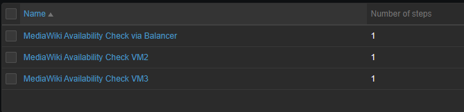
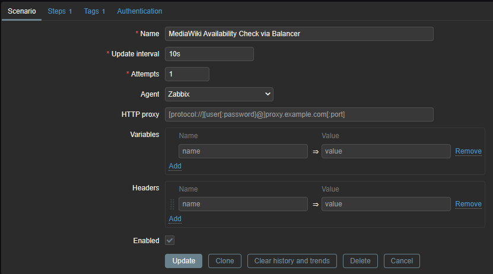

Ответ сервера 200 для нас будет удовлетворительным.
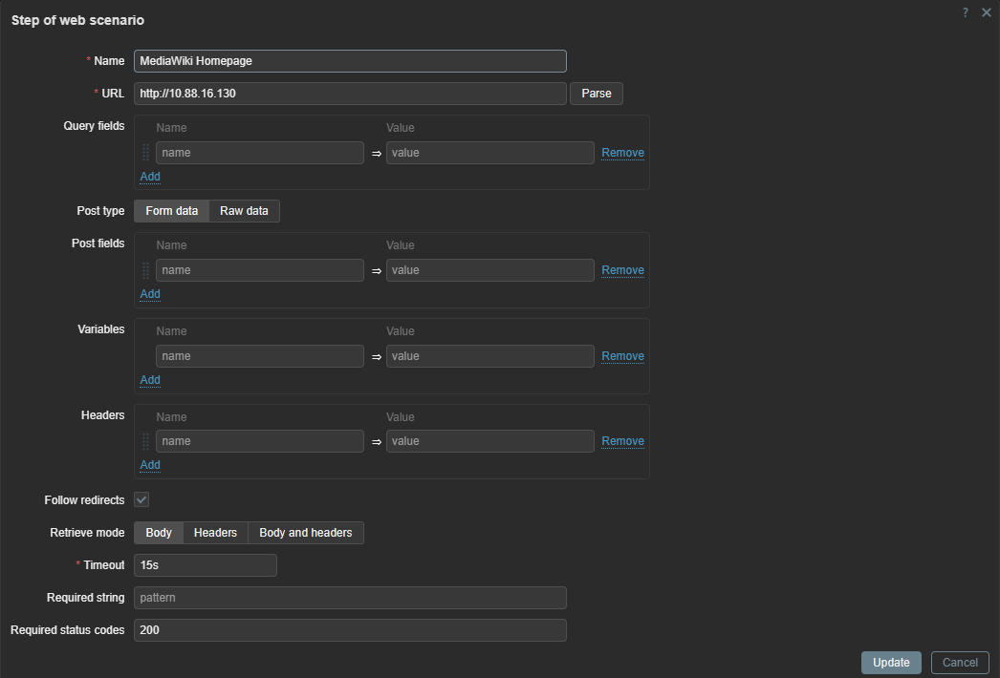

Ещё будем опрашивать Patroni наших ВМ2 и ВМ3, чтобы узнать кто из них главный. 
Нужно не забыть включить редирект и добавить помимо 200 ОК, 503 Unavailable.

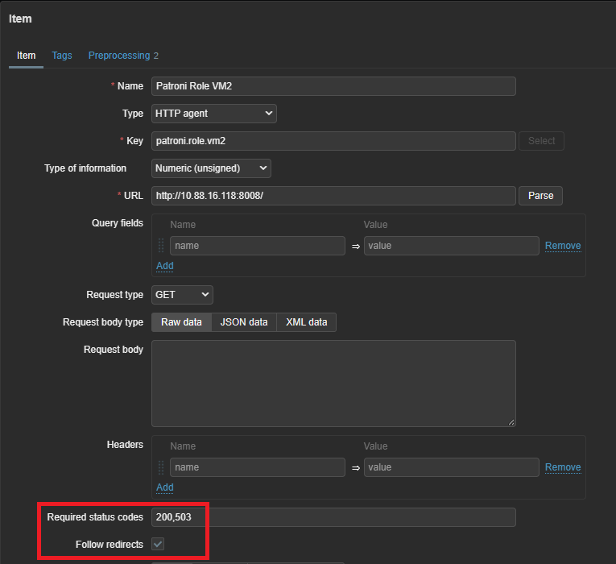
")
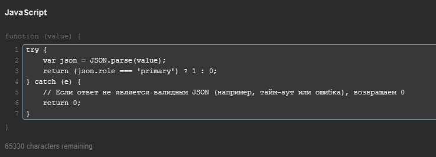
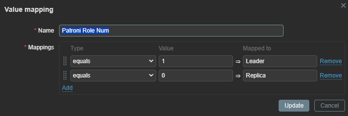

Добавим элементы на дашборд:
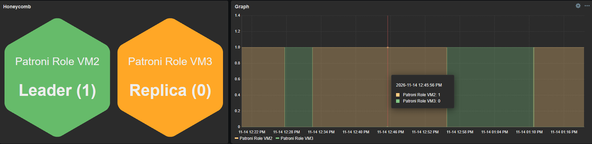


### Шаг 10: Настройка UFW
Для настройки портов выполним на каждой ВМ:
```bash
sudo ufw allow 22/tcp       # SSH
sudo ufw allow 80/tcp       # HTTP
sudo ufw allow 443/tcp      # HTTPS
sudo ufw allow 5432/tcp     # PostgreSQL (HAProxy)
sudo ufw allow 8008/tcp     # Patroni API
sudo ufw allow 2379:2380/tcp # etcd
sudo ufw allow 10050:10051/tcp # Zabbix Server/Agent
sudo ufw enable
```
И на ВМ1 для NFS-сервера и Zabbix:
```bash
sudo ufw allow from 10.88.16.0/20 to any port 2049 proto tcp
sudo ufw allow 5433/tcp # zabbix postgresql
sudo ufw reload
```

### Шаг 11: Отработка падений

1. **Выход из сервера из строя.**

Представим что один из серверов вышел из строя. Выключим только службы а не сам сервер.
```bash
sudo systemctl stop nginx patroni php8.3-fpm nfs-client
```
Если сервис продолжает работать, значит всё отлично. Можем проверить работу скриптом check_health.sh, на "выживших машинах". Этим шагом мы проверили работу балансировщика nginx и HAProxy.
ВМ1 перенаправляет веб-трафик и SQL-трафик на выжившую ВМ. 
В Zabbix мы можем увидеть уведомления что с ВМ2 что-то не так и переключение HAProxy на другую ВМ.

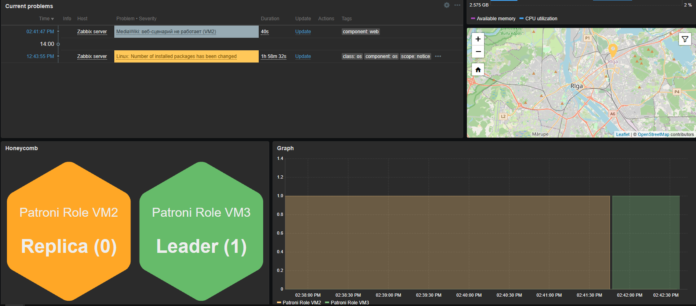

2. **Восстановление данных.**

Не включая отказавшую ВМ, создадим на одной MediaWiki тестовую страницу, после этого выполним скрипт, создающий бэкап, и сразу удалим файловую систему.

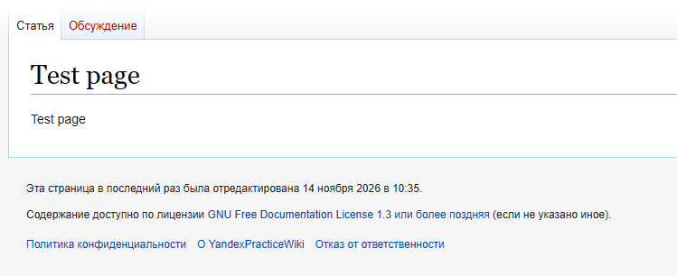

```bash
sudo /usr/local/bin/backup_fs.sh
ls -l /mnt/backups/fs # нужно проверить наличие резервной копии
```
```bash
ubuntu@vm3-app-db-replica:~$ sudo rm -rf /var/www/html/
rm: cannot remove '/var/www/html/images': Device or resource busy # из-за того что каталог примонтирован, папка images не может быть удалена, но она тоже будет пустой.
ubuntu@vm3-app-db-replica:~$ ls -l /var/www/html/
total 4
drwxr-xr-x 2 www-data www-data 4096 Nov 14 11:03 images
ubuntu@vm3-app-db-replica:~$ ls -l /var/www/html/images/
total 0
```
После этого, наш MediaWiki должен выдавать ошибку. 


Теперь перейдём к восстановлению:
```
cd /mnt/backups/fs/
ls -l
sudo tar -zxvf mediawiki_vm*.tar.gz -C /var/www/html/
```
По итогу наш MediaWiki будет работать, а удалённые страницы вернутся.


3. **Удадение БД.** 

На ВМ1 через HAProxy, создадим бэкап, а после удалим БД.
```bash
sudo /usr/local/bin/backup_db.sh
ls -l /srv/shares/backups/db/
psql -h 127.0.0.1 -p 5432 -U postgres -W
```
В консоли:
```sql
DROP DATABASE my_wiki;
\q
```
Сейчас наш MediaWiki, не должен работать.

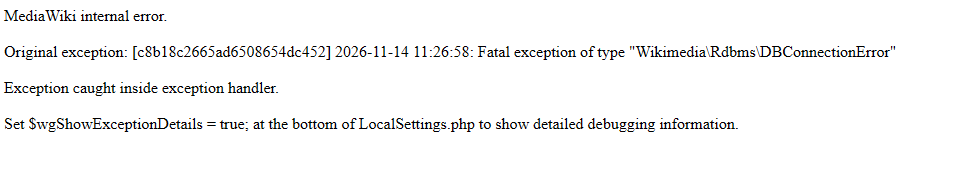

Создадим новую пустую БД:
```bash
psql -h 127.0.0.1 -p 5432 -U postgres -W -c "CREATE DATABASE my_wiki OWNER wikiuser;"
```
И займёмся восстановлением из бэкапа:
```bash
export PGPASSWORD='wiki_password'
pg_restore -h 127.0.0.1 -p 5432 -U wikiuser -d my_wiki /srv/shares/backups/db/my_wiki_*.sql
```
После можем снова наслаждаться нашим сервисом MediaWiki


